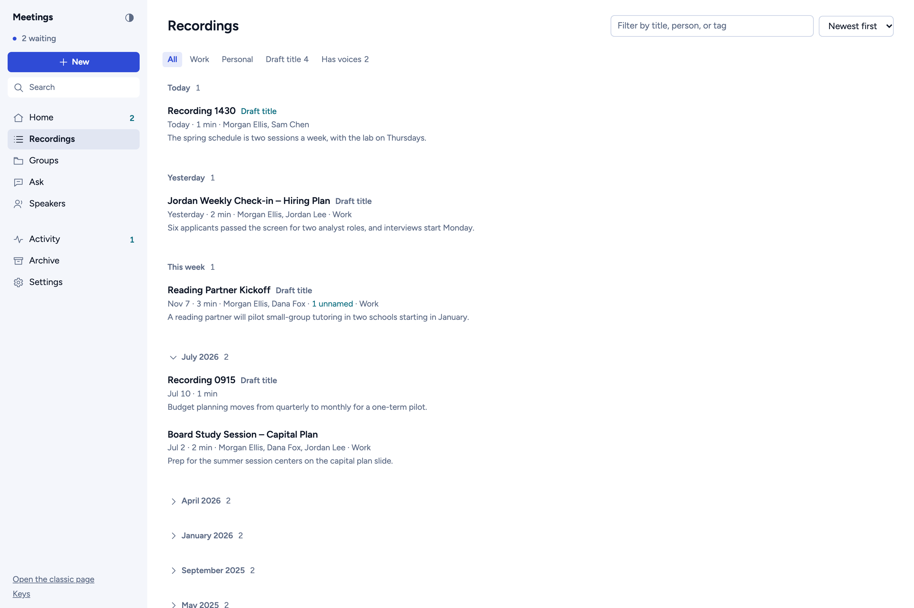
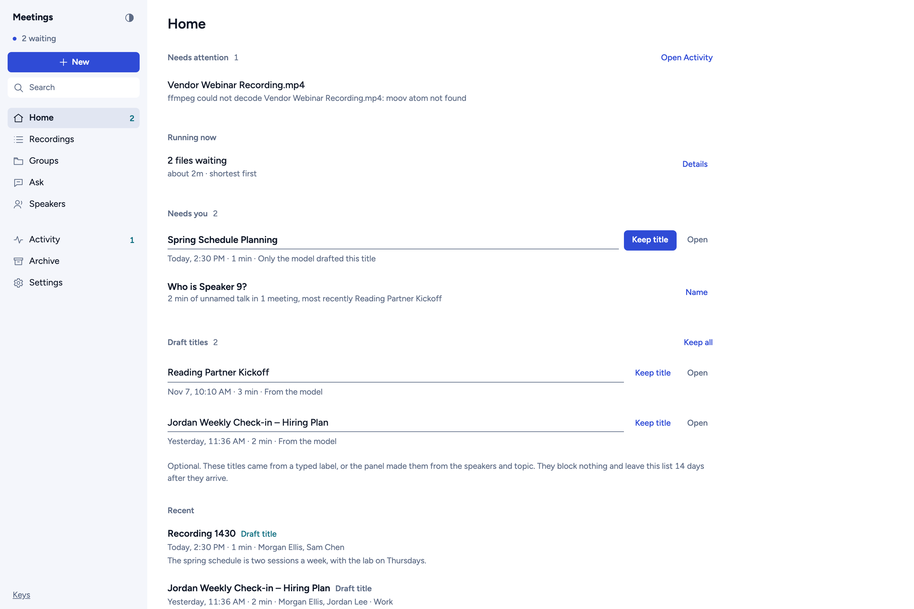
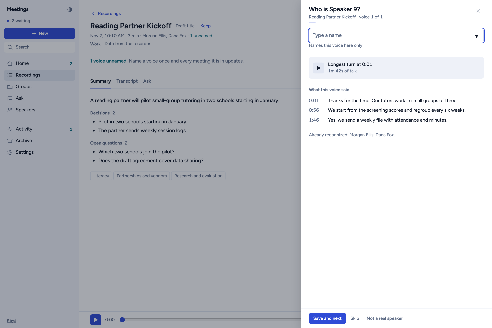
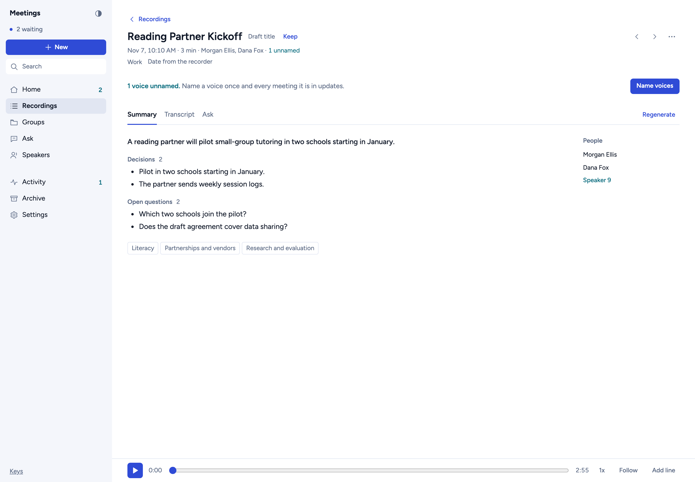
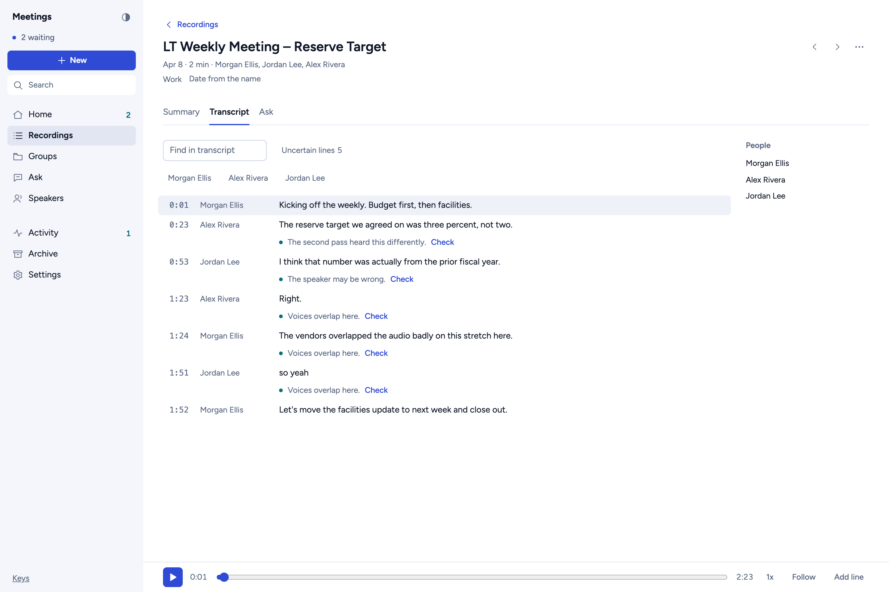
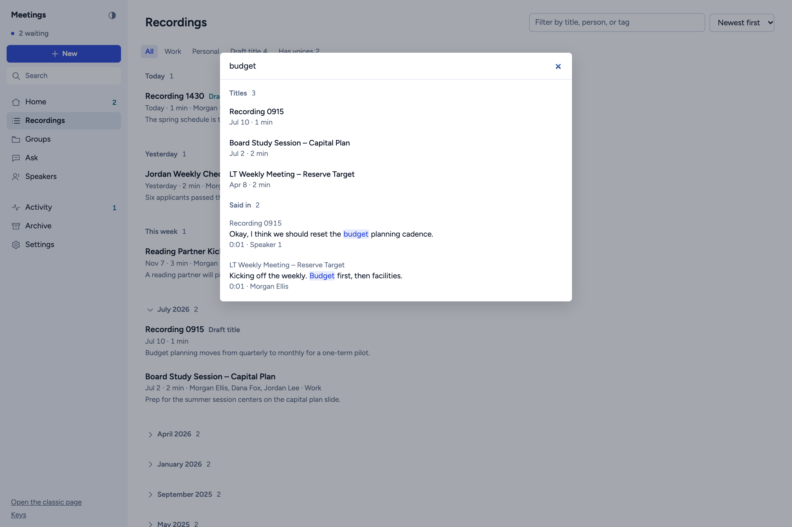
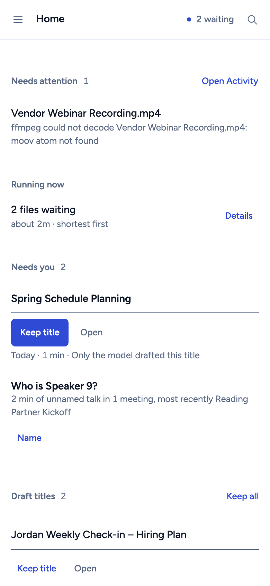
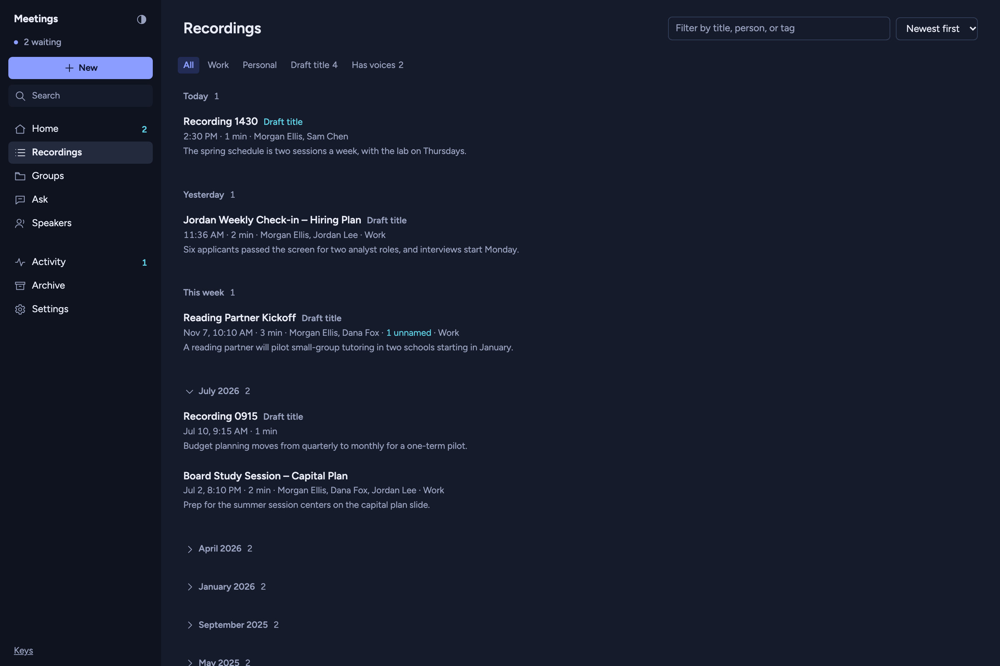

# STT Workflow: private meeting transcripts on a Mac

STT Workflow turns meeting recordings into searchable transcripts with real
names attached, a short description, and a title. Everything runs on your
Mac by default: transcription, speaker separation, voice matching, the
description, and the answers to questions about your meetings. A recording
reaches the library from the menu-bar recorder, from the Voice Memos app,
or from any audio or video file you drop in. You read, fix, and search the
results in a local web panel at `http://127.0.0.1:8737`.

It was built for meetings that cannot go to a cloud service: one-on-ones,
interviews, personnel conversations.



The screenshots in this file come from a synthetic library
(`tools/demo_seed.py`). Every name, title, and line in them is invented.

## Contents

- [What leaves your Mac](#what-leaves-your-mac)
- [Requirements](#requirements)
- [Install](#install)
- [Daily use](#daily-use)
- [Configuration](#configuration)
- [Tools](#tools)
- [Troubleshooting](#troubleshooting)
- [How it works](#how-it-works)
- [Limitations](#limitations)
- [If you record other people](#if-you-record-other-people)

## What leaves your Mac

With the default settings, no audio, transcript text, or voice data leaves
the machine. These are the only network calls the code makes, and each one
is either a download or a feature you turn on yourself:

| What | When | What it sends |
|---|---|---|
| Model downloads from Hugging Face | Install and first use: Parakeet, Whisper, the pyannote models, the speakrs Core ML models, and Qwen3-8B | Requests for model files. No audio or text |
| Model update check | Only when you press the update check in Settings | Asks Hugging Face for the newest revision of each model |
| Cloud transcription (ElevenLabs Scribe, OpenAI, Mistral Voxtral) | Only after you add that provider's key and pick it as the transcription engine | The meeting audio, recompressed to 32 kbps MP3. Speaker separation and voice matching still run locally |
| Cloud assistant (Anthropic or OpenAI) | Only after you add a key and pick it for summaries and Ask | Transcript text for descriptions, titles, and Ask |

Strict meetings never upload, whatever the settings say: strict audio always
uses a local engine, and strict transcripts always use the local model.

Ollama is only ever called on a loopback address (`localhost`, `127.0.0.1`,
or `::1`). For any other host, the code turns Ollama off with a warning and
the MLX model answers instead. The speakrs helper runs under `sandbox-exec`
with all network access denied. The panel listens on `127.0.0.1` only, and
it refuses a request whose Host header is not `127.0.0.1`, `localhost`, or
`[::1]`, so open it by one of those names.

To make the model downloads impossible after setup, set `HF_HUB_OFFLINE=1` in
`stt.env` once the models are cached.

## Requirements

- An Apple Silicon Mac. The transcription engines run on Apple's MLX
  framework, which exists only for Apple Silicon. Intel Macs, Windows, and
  Linux are not supported.
- 16 GB of memory runs the pipeline. 24 GB or more is better for two files
  at a time. Qwen 3.8 (27B) on Ollama needs about 29 GB resident with its
  64k-token context, so it suits a 48 GB Mac. Smaller Macs use the 8B MLX
  model instead.
- About 15 GB of free disk for models, environments, and working audio.
- macOS 14 or later.
- [Homebrew](https://brew.sh). `init.sh` installs `ffmpeg` and
  [`uv`](https://docs.astral.sh/uv/) with it.
- Rust (`brew install rust`) to build the fast speaker-separation helper.
  Without it, the pipeline uses the slower pyannote path.
- A free [Hugging Face](https://huggingface.co) account and a read token.
  The pyannote models are license-gated. They run locally, and nothing is
  paid.
- Optional: [Ollama](https://ollama.com) with `qwen3.8:27b-mlx` pulled.

## Install

```bash
git clone https://github.com/markpaik/stt-workflow && cd stt-workflow
./init.sh
```

`init.sh` walks through the first run and is safe to run again. It checks
the machine (Apple Silicon, memory, disk), installs `ffmpeg` and `uv`,
builds the Python 3.12 environment, builds the speakrs helper and fetches
its models, asks where recordings arrive and where transcripts go, takes
your Hugging Face token, offers to pre-download the models (about 3 GB) and
the local 8B model (about 4.5 GB), and offers to install the automation.

### The same steps by hand

```bash
brew install ffmpeg uv rust
uv venv --python 3.12 .venv          # 3.13 and 3.14 lack wheels for some ML packages
uv pip install --python .venv/bin/python -r requirements.txt

# speakrs: speaker separation on Core ML
(cd native/speakrs && cargo build --release --locked)
.venv/bin/python tools/fetch_speakrs_models.py   # one time, about 270 MB, checksum-verified
```

**Hugging Face token.** Open
[pyannote/speaker-diarization-community-1](https://huggingface.co/pyannote/speaker-diarization-community-1)
while signed in and accept the terms (and those of any repository it lists).
Create a read token at [hf.co/settings/tokens](https://hf.co/settings/tokens).
Copy `stt.env.example` to `stt.env` and set `HF_TOKEN=hf_...`. `stt.env` is
git-ignored.

**Local models for descriptions, titles, and Ask.** The 8B fallback has its
own environment, because its `transformers` version conflicts with the audio
packages:

```bash
uv venv --python 3.12 .venv-llm
uv pip install --python .venv-llm/bin/python mlx-lm 'transformers<5'
```

For the preferred model, install Ollama and run `ollama pull
qwen3.8:27b-mlx`. When Ollama answers on this Mac with that model, new
meetings use it. When it does not, they use Qwen3-8B (4-bit, MLX). With
neither installed, everything else still works, and the description, title
drafts, and Ask stay off.

**Automation.**

```bash
./setup.sh gui-install       # menu-bar app and the panel, started at login
./setup.sh install-agent     # the batch: nightly at 02:00, on new files, every 10 minutes, at login
./setup.sh build-recorder    # the call recorder (microphone and system audio)
```

`setup.sh` writes the launchd plists with your paths, so the repo holds
nothing specific to one machine. Other commands: `uninstall-agent`,
`reload`, `kick` (run the batch now), `status`, `gui-uninstall`,
`gui-restart`.

**Permissions.** The installer prints two binaries that need Full Disk
Access (System Settings > Privacy & Security): `/usr/bin/caffeinate` and the
resolved Python. Without it, the batch cannot read iCloud Drive or the Voice
Memos library. The recorder needs Microphone and "System Audio Recording
Only". The panel walks through both.

## Daily use

### A recording arrives

A recording can come from three places:

- **The menu-bar recorder.** Start, pause, and stop a call from the menu bar.
  It records your microphone and the system audio on separate channels, and
  it warns you, during and after the capture, if macOS stops delivering
  audio.
- **Voice Memos.** At the start of every batch run, the sync reads the Voice
  Memos library on this Mac and copies each finished memo that passes its
  rules: recorded on or after `STT_VOICEMEMOS_SINCE`, at least 3 minutes
  long, unchanged for 5 minutes, never copied before, and not in Recently
  Deleted. It reads a private copy of the Voice Memos database and never
  writes to the library. The memo's start time becomes the meeting date, and
  a title you typed in Voice Memos becomes the meeting title.
- **A file.** Drop audio or video anywhere on the panel, use Import files on
  the Activity page, or put a file in the watched folder (iCloud Drive's
  `Voice Recordings` by default). Anything ffmpeg reads works.

The batch and the panel skip three kinds of file that are not recordings:
an empty (0-byte) file, until it holds data, a hidden (dot) file, and an
Office lock file (`~$name`).

The batch runs when a file lands while the Mac is awake, every 10 minutes,
nightly at 02:00, and at login. It runs the shortest file first and picks
again after every file, so a short call never waits behind a long board
meeting. The status pill in the sidebar shows the stage ("Transcribing",
"Speakers", "Summary"), the percent, and the time left, estimated from this
Mac's own past runs. The original file is deleted only after the stored copy
is verified to match it.

A file that fails stays in the watched folder, and the next run tries it
again. A file that ffmpeg cannot read, or one that fails three runs in a row
without changing, is set aside: automatic runs skip it until the file
changes, and Retry on the Activity page runs it at once. The error shows
ffmpeg's own reason ("moov atom not found", "no audio track"). A full disk
never counts against the file.

When a file finishes, Home shows it under Needs you if it needs a decision.
Each meeting is a folder named `YYYY-MM-DD <title>` with the audio, a
readable `.txt`, the `.json` record (segments, words, speakers, flags,
confidence), the caches, and your edits. A folder name is cut to 120 bytes,
so every file name in the folder stays under the 255-byte limit of macOS.



Recordings lists every meeting by day and month with its title, date,
length, people, and gist. A recording under a minute shows its length in
seconds ("48 sec").

### Naming speakers

Name a voice once and every past and future meeting with that voice updates
in seconds. Re-labeling reads cached voice embeddings, so it never processes
the audio again. An unnamed voice keeps the same number in every meeting
("Speaker 9" is one person everywhere). A voice gets a name only when it
matches an enrolled person by a clear score and a clear margin over the
next-best person, so a stranger who sounds like a colleague is not given the
colleague's name.

The voice sheet opens from Home's "Who is Speaker 9?" card, from the notice
on a meeting page, from any unnamed speaker in a transcript, or with `v`. It
shows the voice's longest turn to play, a few things it said, and a name box
that offers enrolled names. Typing an existing name merges the voice into
that person, and a name that differs only in case (`dana fox`) joins the
enrolled spelling. When the voice matches that person's saved samples
poorly, the sheet says it may be the wrong person and asks you to confirm.
"Not a real speaker" drops a noise or echo voice from this meeting.
Only voices with at least a minute of talk ask for a name, and a public
download asks for none.



A name is one line of plain text, at most 200 characters. The panel,
`enroll.py`, a rename, and a meeting-only label all trim the edges and
refuse an empty name. They also refuse a name that holds a line break, a
tab, a bidirectional control such as U+202E, or a zero-width space. Those
characters split the transcript header, reorder how a name displays, or
make two names that look the same.

When a voice is named, renamed, merged, or relabeled, the description is
re-rendered with the new names. No model runs for that: the description is
stored as a template with a token for each speaker.

The Speakers page lists unknown voices (most meetings first), named people
with their samples, and hidden voices. From there you can play a voice,
remove or move a sample, rename someone everywhere, merge two people, hide a
voice, or remove an enrolled person. A rename or merge onto an enrolled
person runs the same voice check as naming and asks you to confirm when the
voices do not match. A person keeps up to five samples. Samples from
different meetings and rooms identify someone better than several clips
from one recording.

### Reviewing a meeting

A meeting page has three tabs (Summary, Transcript, Ask) and the audio bar
docked at the bottom: play, scrub, 0.75x to 2x, Follow, and Add line.



The Summary tab shows the description: a gist of 20 words or fewer, then up
to 6 Decisions and up to 4 Open questions, then 3 to 5 topic tags. A click
on a tag opens Recordings filtered to that tag. Regenerate writes a new
description. When the model replies with nothing usable, the old
description stays.

The Transcript tab shows every line with its time, speaker, and text. Lines
the pipeline is unsure about say why ("Voices overlap here", "The speaker may
be wrong", "The second pass heard this differently") and offer Check.



Check, or `n`, starts a walk through the uncertain lines from top to bottom.
A bar under the tabs plays the span and offers Accept (Enter or `a`), Use
alt (`u`, the second engine's words, when verify ran), Skip, and Done. It
also accepts all sub-second crumbs at once, and accepts every remaining line
behind a confirm. The pencil on any line edits it: fix the text, change the
speaker (including "New person..."), split a line, remove a line, or listen
again with a different engine. Your edits live in a sidecar file and survive
every relabel and reprocess.

### Titles

A recurring meeting is titled `<series name> – <short topic>`, for example
`LT Weekly Meeting – Reserve Target` or `Jordan Weekly Check-in – Hiring
Plan`. A one-off meeting is titled by its topic alone. The model never writes
the title as free text. It picks a series from the catalog in
`stt/series.py` (or "one-off"), the other person for a one-on-one series,
and a short topic, and the code builds the title from those parts. That
keeps every meeting of a series under one spelling. Add a series to the
catalog, not to a prompt.

A title you typed (in Voice Memos or in the file name) is kept. A meeting
that arrives with only a default name ("Recording 1430") gets the model's
draft and a Needs you card with Keep title. Draft titles that came from a
typed label or from the catalog appear in an optional Draft titles list for
14 days, with Keep title and Keep all. To change a title, click it on the
meeting page or use Rename in the row menu. Set date in the same menu
changes the date, which must fall between 2000 and the end of next year.
The folder follows the title and the date:
`2026-04-08 LT Weekly Meeting – Reserve Target`.

A title stays on one line: a line break becomes a space, and a
bidirectional control or a zero-width space is dropped. A colon or a slash
is kept. The title shows as typed (`Dana 1:1`, `Q3/Q4 Planning`), and the
folder, which cannot hold either one, says `Dana 1-1` and `Q3-Q4 Planning`.
Saving a title the meeting already has never renames its folder, and a
same-day twin keeps its `(2)` or `(3)`.

### Search and Ask

`/` or Cmd K opens search from any page. It lists matching titles first,
then "Said in" lines with their time. A hit opens the meeting with the audio
cued to that line. Filters can be typed inline: `after:2026-10-01`,
`before:2026-10-31`, `from:<speaker>`, `in:<group>`, `route:voice_memo`, and
`dated:typed`. The Recordings filter field matches a title, a person, or a
topic tag.



Two letters are enough to search. Typed in capitals (`AI`, `IT`, `HR`), a
two-letter word is an acronym and matches only where it is written in
capitals, so `IT` skips every "it". In lower case it matches whole words. A
two-letter stop word such as "is" or "of" appears in most lines, so it does
not search on its own, and the palette says so instead of "No matches."

Ask answers questions from your transcripts. On a meeting page, the Ask tab
answers from that one meeting, and its thread lasts until you reload. The
Ask page answers from all recordings, a group, or the last 30 days. It
retrieves matching lines from the search index, cites each answer by
meeting and time, and saves the thread. When it finds nothing, it says so
and shows the closest search hits instead of inventing an answer. A first
question that finds nothing starts no saved thread: the page shows the reply
marked "Not saved: nothing was found." A follow-up that finds nothing is
saved in its thread.

Groups collects meetings that belong together (the same title words, or the
same people at the same hour). A group shows its total length in seconds
under a minute, in minutes under an hour, and in hours after that. "Not part
of this group" corrects a group, and nothing on disk moves.

### Export

The row menu and the meeting page's menu offer Export Word, Export PDF, Copy
transcript (plain text to the clipboard), and Show files. Word and PDF copies
land in `~/Downloads` and open in Finder. They leave the data home, so treat
them as shared copies. `STT_EXPORT_DIR` sends them elsewhere. PDF uses the
installed Google Chrome, headless, on a throwaway profile. A PDF that Chrome
wrote counts even if Chrome then exits with an error, and a failed PDF
leaves no file behind.

### The batch and the description

After each file, the batch writes the description and draft title with the
local model. When the queue is empty, it does two more things:

- It regenerates up to 3 descriptions that a Redo left out of date. The
  meeting page says when a description is out of date, and it stays
  readable until the new one lands. A refresh that gets no usable reply
  waits longer before each new try, up to a day.
- It writes any description from this run that is still missing.

The Activity page holds the machinery: Process all new, Import files, Pause
or Resume, Stop, queued runs, waiting files (Process, Hold, Delete), failures
with their full error text (Retry, Dismiss), history, and duplicates. The
four run options apply to the next manual run:

- **Two at a time** runs two workers, for a backlog.
- **Strict**, for confidential conversations, never guesses an uncertain
  speaker (it flags the line instead) and never sends audio or text to a
  cloud service. A meeting processed in strict stays strict: a Redo or a
  speaker re-identify keeps it on.
- **Verify** transcribes with a second, different engine and flags every
  place the two disagree, with both readings.
- **One-time speakers**, for focus groups, never adds unnamed voices to the
  speaker library and keeps no samples of them.

To let a run finish its current file and then stop, create
`stop_after_file.flag` in the project folder. Stop ends the batch and every
process it started (the workers, ffmpeg, the speakrs helper), and leaves
the shell or script that started it running. A run that is cut off mid-file
runs that file again next time.

### On a phone-width window

Below 900 px the sidebar becomes a menu, rows wrap, and nothing scrolls
sideways.



### Light and dark

The panel follows macOS. The theme button next to the wordmark cycles auto,
light, and dark, and the panel remembers the choice.



### Keys

| Key | Does |
|---|---|
| `/`, Cmd K | Search |
| `?` | The key sheet |
| `g` then `h` `r` `g` `q` `a` `s` `e` `,` | Home, Recordings, Groups, Ask, Activity, Speakers, Archive, Settings |
| `j` `k`, Enter, `x` | Move, open, select in a list |
| `1` `2` `3` | Summary, Transcript, Ask on a meeting |
| `[` `]` | Previous and next recording |
| Space | Play or pause |
| `v` | Name voices |
| `n` `p` | Next and previous uncertain line |
| Esc | Back out one layer |

### Menu bar and command line

The menu bar shows new results, starts and stops recording, runs the batch
now, stops a run, pauses automation, and opens the panel, the transcripts
folder, and the logs.

```bash
./run.sh batch --dry-run                          # what would process, and any empty file it skips (works while a batch runs)
./run.sh batch --strict --files "Interview.m4a"   # strict: flag, never guess, never upload
./run.sh batch --verify --parallel 2              # second engine, two workers
./run.sh relabel --all                            # apply names to every meeting
./run.sh enroll --from-meeting "2026-05-21 Team Sync"   # list that meeting's speakers
./run.sh enroll --from-meeting "2026-05-21 Team Sync" --speaker SPEAKER_01 --name "Ana Ortiz"
./run.sh enroll --list
./run.sh test                                     # the test suite (about 2,000 tests)
```

A `--files` name that matches no file in the watched folder prints `not
found in source: <name>`, and one that names an empty file says so.

## Configuration

Settings live in `stt.env` (git-ignored). The panel's Settings page writes
the common ones: automation (the master switch, folder watch, the nightly
run, Voice Memos sync), the transcription engine, the assistant for
summaries and Ask, cloud keys, the recorder, storage folders, and
appearance. The panel never displays a saved key again. It shows only that
a key exists.

An unreadable `STT_ASR_BACKEND`, `STT_DIARIZER`, `STT_SPEAKRS_AHC`,
`STT_SPEAKRS_TIMEOUT_SEC`, `STT_OLLAMA_URL`, or `STT_LLM_QUIET_HOURS` prints
one warning that names it, and the code falls back as the tables below say.
`./run.sh py tools/doctor.py check` lists a bad `STT_ASR_BACKEND`,
`STT_OLLAMA_URL`, or `STT_LLM_QUIET_HOURS` as `bad_setting`.

### Folders and sources

| Setting | Default | What it does |
|---|---|---|
| `STT_ICLOUD_DIR` | iCloud Drive `Voice Recordings` | The watched folder |
| `STT_MEETINGS_DIR` | `~/Projects/brain/meetings` | Where meetings are stored |
| `STT_RECORDINGS_DIR` | `~/Library/Application Support/com.stt-workflow/recordings` | Where the recorder saves captures |
| `STT_EXPORT_DIR` | `~/Downloads` | Where Word and PDF exports go. A relative path is under your home folder. Under `STT_HOME` the default is `$STT_HOME/exports` |
| `STT_VOICEMEMOS_SYNC` | `1` | `0` turns the Voice Memos sync off |
| `STT_VOICEMEMOS_SINCE` | `2026-11-02` | The sync copies memos recorded on or after this day |
| `STT_VOICEMEMOS_PLACES` | empty | Comma-separated place names that Voice Memos uses as default titles here, so they are not read as typed titles |
| `STT_MOVE_AFTER_SUCCESS` | `1` | `0` keeps the originals in the watched folder |
| `STT_MIC_SPEAKER` | empty | Your name, so the recorder's microphone channel is labeled as you |

When you pick a new transcripts folder in Settings, the panel asks before it
uses a folder that holds other files or old flat-layout meetings. Once you
confirm, it moves each old flat-layout meeting (a transcript `.json` the
pipeline wrote, with its `.txt`) into its own folder. Every other file stays
where it is.

### Engines

| Setting | Default | What it does |
|---|---|---|
| `STT_ASR_BACKEND` | `parakeet` | The transcription engine: `parakeet`, `mlxwhisper`, `cloud:scribe`, `cloud:openai`, or `cloud:voxtral`. Any other value prints a warning and runs Parakeet. The Settings page writes it |
| `STT_WHISPER_MLX_MODEL` | `large-v3` | The Whisper variant for `mlxwhisper`: `large-v3` or `turbo` |
| `STT_DIARIZER` | `speakrs` | `pyannote` forces the CPU path. Any other value prints a warning and keeps speakrs |
| `STT_SPEAKRS_AHC` | `0.55` | The speakrs merge threshold. A value that is not a number 0 or above uses the default |
| `STT_SPEAKRS_TIMEOUT_SEC` | `3600` | How long the speakrs helper may run on one file. A value that is not a whole number above 0 uses the default |
| `STT_RECLUSTER` | `1` | After speakrs, moves a turn whose voice fits another speaker in the meeting better than its own. `0` turns it off |
| `STT_STRICT`, `STT_VERIFY` | `0` | Make strict or verify the default for every run |
| `STT_PUNCTUATE` | `1` | Punctuation cleanup |
| `STT_NAMING_THRESHOLD`, `STT_NAMING_MARGIN` | `0.60`, `0.15` | The score and margin a voice needs to get a name |
| `STT_ELEVENLABS_KEY`, `STT_OPENAI_KEY`, `STT_MISTRAL_KEY` | empty | Cloud transcription keys |
| `STT_LLM_BACKEND` | `local` | `anthropic` or `openai` sends transcript text to that service for descriptions and Ask |
| `STT_ANTHROPIC_KEY` | empty | The key for the Anthropic assistant |

### The local model

| Setting | Default | What it does |
|---|---|---|
| `STT_LOCAL_LLM` | `auto` | `auto` uses Ollama when it answers and MLX otherwise. `ollama` or `mlx` picks one |
| `STT_OLLAMA_URL` | `http://localhost:11434` | `off` turns Ollama off. A value with no scheme (`localhost:11434`) is read as `http://`, and one with no port either (`127.0.0.1`) is on port 11434, as Ollama reads its own `OLLAMA_HOST`. A host that is not loopback, a port that is not a number, or a scheme other than http or https turns Ollama off with one warning |
| `STT_OLLAMA_MODEL` | `qwen3.8:27b-mlx` | The Ollama model |
| `STT_OLLAMA_KEEP_ALIVE` | `30m` | How long Ollama keeps the model loaded after a call |

### Hardware limits for the local model

Local model runs go at full speed by default: normal priority and no rest
between meetings. If the fan bothers you, quiet mode is opt-in: raise
`STT_LLM_NICE` and the rest settings. The settings are read fresh from
`stt.env`, with no restart.

| Setting | Default | What it does |
|---|---|---|
| `STT_LLM_NICE` | `0` | `0` keeps normal priority. Above 0 is quiet mode: before each Ollama call, the `ollama` server and runner processes are set to this nice value and put on background QoS (`taskpolicy -b`, which also lowers their GPU priority). The MLX fallback starts at this nice value under `taskpolicy -b`. The value is absolute, so repeated calls never push it higher. A process already above it stays there, because macOS lets a user lower priority but not raise it. A failure here never stops a run |
| `STT_LLM_QUIET_HOURS` | `07:00-22:00` | The daytime window for the rest rule. It may wrap past midnight. The two times may be joined by `-`, an en dash, or `to`, and a bare hour works (`10-12`). The same time at both ends (`10:00-10:00`) means all day, so the model rests after every meeting. A value that cannot be read uses the default |
| `STT_LLM_REST_RATIO` | `0` | Inside the quiet hours, a loop over many meetings (`tools/retitle_all.py`, the batch's description sweeps) rests after each meeting for this multiple of the time that meeting took |
| `STT_LLM_REST_MIN_SEC` | `0` | The shortest rest inside the quiet hours |
| `STT_LLM_REST_RATIO_NIGHT` | `0` | The rest multiple outside the quiet hours |

The batch logs each rest. A single panel request (Regenerate, Ask) never
rests. Requests go through `llm.lock` one at a time. Ollama's `num_thread`
and `num_gpu` stay at the server's defaults.

## Tools

Run each one with `./run.sh py tools/<name>.py`. A tool that changes the
library does a dry run first, needs `--apply` to write, and keeps an undo
journal outside the repo (`~/Library/Application Support/com.stt-workflow/migration`).

| Tool | What it does |
|---|---|
| `retitle_all.py` | Retitles the library by the series catalog and writes new descriptions. `--only "Check-in" --limit 5` tries a few first. `--undo` prints the reversal, and `--undo --apply` runs it |
| `iso_rename.py` | Moves every folder from the old `<title> MMDDYYYY` form to `YYYY-MM-DD <title>`. `--undo` prints the reversal, and `--undo --apply` runs it |
| `fetch_speakrs_models.py` | Downloads the speakrs Core ML models once, pinned and checksum-verified |
| `doctor.py` | Checks the meeting store and voice registries (`check`, `check --deep`), repairs what is safe (`fix --apply`), and undoes a repair (`undo RUN --apply`) |
| `registry_doctor.py` | Checks and repairs the voice registries alone |
| `rebuild_voiceprints.py` | Rebuilds the voiceprint registry from meeting caches after a loss |
| `purge.py` | Removes one meeting from every store: folder, manifest, search index, voice samples, and unknown voices heard only there |
| `fix_dates.py` | Corrects dates that a better source contradicts (a Voice Memos start time, a short typed date) |
| `backfill_keys.py` | Adds missing store keys (`title`, `source_name`, `audio_fp`, `date_source`, `recorded_at`) |
| `restamp_folders.py` | Adds the date to folders that predate the date-in-name rule |
| `demo_seed.py` | Builds a synthetic library for development and screenshots |
| `next_screens.py` | Screenshots every panel page against a running demo panel and fails on a sideways scroll |
| `diar_eval.py`, `synth_corpus.py`, `ask_eval.py`, `eta_backtest.py` | Accuracy and estimate harnesses for tuning |

To try the panel on fake data:

```bash
.venv/bin/python tools/demo_seed.py --dir qa/demo_home
STT_HOME=$PWD/qa/demo_home STT_PANEL_PORT=8747 .venv/bin/python -m gui.server
```

`STT_HOME` moves every data path (meetings, folders, voiceprints, state,
the launchd plist) under that folder, so nothing there can touch your real
meetings. Under `STT_HOME`, the batch and `run.sh` read `$STT_HOME/stt.env`,
never the checkout's own, and exports land in `$STT_HOME/exports`.

## Troubleshooting

- **Nothing arrives from Voice Memos.** Run `./run.sh py tools/doctor.py
  check`. A `voicememos_denied` finding means the Python the batch runs lacks
  Full Disk Access. A memo shorter than 3 minutes, one still recording, one
  in Recently Deleted, or one from before `STT_VOICEMEMOS_SINCE` is skipped
  on purpose.
- **Speaker separation is slow.** The speakrs helper or its models are
  missing, so the pipeline fell back to pyannote. Install Rust, then re-run
  `./init.sh`, or build `native/speakrs` and run
  `tools/fetch_speakrs_models.py`.
- **No descriptions or titles.** Neither local model is available. Check
  that Ollama answers at `STT_OLLAMA_URL` with the model pulled, or that
  `.venv-llm` exists. A `bad_setting` finding from the doctor names a value
  it could not read.
- **A description is out of date.** A Redo marks it so. The batch refreshes
  it when the queue is empty, or press Regenerate.
- **The fan runs during a retitle.** Turn on quiet mode: set `STT_LLM_NICE`
  to 10 and `STT_LLM_REST_RATIO` to 1. A model process lowered earlier keeps
  its priority until Ollama restarts.
- **A file failed.** The Activity page shows the error with Retry. A file
  that ffmpeg cannot read, or one that failed three times without changing,
  waits there until it changes or you press Retry. The logs are in `logs/`
  (`stt.out.log`, `stt.err.log`).
- **The panel says "Something went wrong in the panel. The details are in
  the panel log."** The route and the full traceback are in
  `logs/gui.err.log`, and never on the page. A request the panel cannot use
  (a body that is not one JSON object, a missing field, or a field of the
  wrong type) gets HTTP 400 and a message that names the field.
- **The registry looks empty but named meetings exist.** The batch warns
  about this at the start of a run. Every registry write keeps a rolling
  backup, and `tools/rebuild_voiceprints.py --apply` rebuilds it from the
  meeting caches.
- **Naming a voice says the registry cannot be read.** A damaged
  `registry.json` is never written over. Restore `registry.json.bak`, or run
  `tools/rebuild_voiceprints.py --apply`, which moves the damaged file aside
  first.
- **Overnight runs do not happen.** They need AC power. For a true night
  wake: `sudo pmset repeat wakeorpoweron MTWRFSU 01:57:00`.

## How it works

```
recorder / Voice Memos sync / watched folder / drop
        │
        ▼
   ffmpeg ─► ASR: Parakeet TDT 0.6B v3 on MLX (or Whisper, or a cloud engine)
        │
        ├─► speaker separation: speakrs on Core ML (pyannote on CPU as fallback)
        ├─► turn recluster (speakrs only)
        ├─► voiceprint matching and identity refinement
        ▼
   words matched to speakers ─► punctuation ─► .txt + .json + cached embeddings
        │
        ▼
   description and title: Qwen 3.8 on Ollama, else Qwen3-8B on MLX
        │
        ▼
   panel: review edits (sidecar), naming (relabel from cache), FTS5 search, Ask
```

- `run_batch.py` is the batch: the Voice Memos sync, the queue, one lock
  for the whole run, and the end-of-run sweeps.
- `stt/` holds the pipeline. `pipeline.py` runs one file. `diarize.py` and
  `speakrs_diar.py` separate speakers. `recluster.py` moves a speakrs turn
  whose own voice fits another speaker in the meeting better than its own.
  `identify.py`, `refine.py`, and `unknowns.py` match voices. `summarize.py`
  writes descriptions and answers Ask. `series.py` holds the series catalog
  and the tag vocabulary. `speaker_text.py` re-renders descriptions when
  names change. `voicememos.py` is the sync. `search.py` is the FTS5 index.
  `names.py` holds the rules for a typed name or title.
- `native/speakrs` is the Rust helper around speakrs 0.7.0, the pyannote
  community-1 recipe on Core ML. On the bakeoff meetings it produced the
  same names as pyannote.
- `native/recorder.swift` is the call recorder.
- `gui/server.py` serves the panel and its API. The page is
  `gui/static/next.html` with `next.css` and the `next*.js` scripts, with no
  build step. `gui/DESIGN.md` holds the panel's design rules, and
  `docs/store-contract.md` says what the meeting store promises its readers.
- Every write to a meeting takes that meeting's lock and replaces the file
  atomically, so a reader never sees half a transcript.

Model attribution (CC-BY-4.0 weights) is in [NOTICE.md](NOTICE.md).

## Limitations

- **Overlapping speech gives the most speaker errors.** When two people talk
  at once, no open diarizer splits the words cleanly. The pipeline flags
  overlap for review.
- **Audio quality matters more than the model.** A phone on a conference
  table picks up echo, fan noise, and distance. A recording made close to
  each speaker in a quiet room helps more than any setting.
- **More speakers mean more mistakes.** Two or three people separate well.
  A large group, or quick back-and-forth, can split one voice into two or
  merge two into one.
- **Names depend on enrollment.** Someone gets a name only after you name
  their voice, and a very different room or microphone can still miss.
- **Cloud services are more accurate on hard audio.** For a recording that
  can leave the machine, the cloud engines are an option and still get
  local names.

## If you record other people

This tool stores voiceprints, which are biometric data, and verbatim
records of what people said.

- Files the pipeline writes are owner-only. Every process that imports
  `stt.config` (the batch, the panel, `enroll.py`, `relabel.py`, and every
  tool script) runs with umask 077, and the voiceprints folder is kept
  0700. Files from before this rule keep their old mode until rewritten.
  The doctor reports them as `loose_mode`, and `tools/doctor.py fix --apply`
  makes them owner-only.
- `.gitignore` keeps voiceprints, transcripts, audio, tokens, and runtime
  state out of git. Check it before you change output paths.
- Word and PDF exports leave the data home. Treat them as shared copies.
- Know your local recording-consent law (one-party or all-party) and your
  workplace's policy before you record routinely.
- The panel's Delete removes the meeting but keeps the enrolled voice
  samples taken from it. `tools/purge.py` also removes those samples and
  every unknown voice heard only in that meeting.

## License

[MIT](LICENSE)
